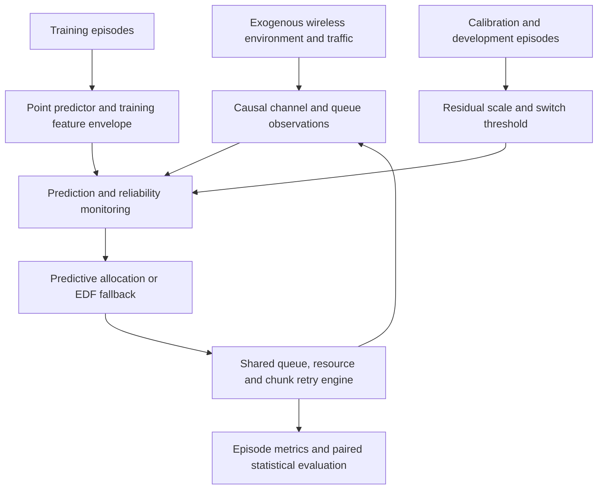

# Predictive QoS-Aware Scheduling for Mobile Robots

**Uncertainty-Aware Radio Resource Allocation for Reliable Low-Latency Wireless Communication**

[](https://github.com/omidrahimirad/Predictive-QoS-aware-Scheduling-for-Mobile-Robots/actions/workflows/ci.yml)

An independent **NR-inspired, 6G-oriented Python research simulator** investigating when
channel prediction helps deliver mobile-robot control packets before their deadlines—and
when a conservative scheduler is preferable. A learned forecast can justify earlier
service before channel deterioration, but it can also mislead scheduling after the radio
environment changes. Classical EDF is therefore a central comparator.

Version 0.2 adds a causal prediction-error monitor and training-feature shift detector.
They switch the existing predictive allocator to EDF when forecast reliability looks poor.
The contribution is an inspectable algorithm and a reproducible evaluation, with explicit
negative findings and throughput trade-offs.


## Research findings

- Historical prediction was not universally superior: EDF had fewer deadline violations
  under severe blockage and OOD, while learned SINR forecasts could deteriorate sharply.
- The new study uses fresh final seed ranges, separated from training, calibration,
  development and all previously published test episodes.
- Robust reduces violations versus Predictive by **13.396 pp** in the deterioration
  scenario, while BE falls from **8.061 to 6.311 Mbit/s**. Under severe blockage it
  remains **7.632 pp worse than EDF**; D/G/H reduce exactly to EDF.
- Reliability awareness is a heuristic mitigation. Read the [new measured report](examples/robust_scheduling_v2/full/REPORT.md)
  for paired effects against Predictive and EDF, including unfavorable conditions.
- The development BE-goodput floor of 90% of PF was **infeasible** for every candidate
  switch threshold. The selected setting minimizes that deficit; it does not guarantee
  an acceptable goodput floor on final episodes.

See [RESULTS](docs/RESULTS.md) for historical and new evidence, clearly distinguished.
The confidence score is a diagnostic, **not a calibrated probability** or deadline guarantee.

## Features

- Synthetic robot mobility, correlated fading, attenuation zones and unexpected outages.
- Finite control/BE queues, partial service, chunk retries and delayed ACK-based PF rates.
- Causal delayed/noisy observations; train-only Ridge/ExtraTrees SINR prediction.
- Interpretable Predictive/EDF switch using matured observed residuals and feature shift.
- Matched exogenous traces, independent episode statistics, frozen model/config/source hashes.
- Rebuildable raw metrics, paired bootstrap tables, ablations and PNG/SVG scientific figures.

## Architecture



The queue engine retains a shared physical-completion eligibility abstraction; it is
not a complete ACK-limited transmitter protocol. See the [audit](docs/EXPERIMENT_PROTOCOL.md#simulator-audit).

| Component | Source directory | Responsibility |
|---|---|---|
| Model and contracts | `src/pqos/config.py`, `entities.py` | Units, validation, immutable observations |
| Environment | `src/pqos/traces.py` | Named RNG streams and policy-independent traces |
| Simulator | `src/pqos/simulator.py` | Service, physical completion, feedback and conservation |
| Scheduling | `src/pqos/schedulers/` | Existing greedy scores and causal robust gate |
| Learning | `src/pqos/prediction/` | Point forecasts, training envelope, observable residual calibration |
| Experiments | `src/pqos/experiments/` | Development, freeze, checkpoints, statistics and plots |

## Algorithms

| Policy | Decision information and role |
|---|---|
| Round Robin | Rotating eligible UEs; simple comparator |
| Proportional Fair | Current expected service / ACK-updated average rate |
| EDF | Nearest eligible control deadline; PF when control demand is covered |
| Reactive QoS | Current expected service, cumulative deadline demand, backlog and PF |
| Persistence | Constant current expected-service forecast; **equivalent to Reactive** under the common score |
| Predictive QoS | Learned near-future service, deadline demand and current-channel opportunity |
| Robust Predictive | Existing Predictive if reliability risk is low; exact EDF otherwise |
| Robust, no adaptation | Same monitor, risk-driven switch disabled; invalid-forecast EDF protection retained |
| Diagnostic Oracle | True future channel reference; unavailable to deployable policies and not an optimal bound |

All policies share traces, arrivals, budgets, error draws, queues and retry rules. Ordinary
policies cannot use future channels, future traffic or unmatured forecast errors.
[ROBUST_SCHEDULING](docs/ROBUST_SCHEDULING.md) defines the equations and failure modes.

## Reproduction

Python 3.11 or 3.12, CPU only; no GPU, external dataset or notebook required. Install
[uv](https://docs.astral.sh/uv/getting-started/installation/) and use the locked environment:

```bash
git clone https://github.com/omidrahimirad/Predictive-QoS-aware-Scheduling-for-Mobile-Robots.git
cd Predictive-QoS-aware-Scheduling-for-Mobile-Robots
uv sync --locked --extra dev
uv run pytest -q
uv run ruff check src tests
uv run ruff format --check src tests
uv run mypy
```

Run the new complete training/calibration/development pipeline, freeze the clean source,
and execute a small exploratory study:

```bash
uv run pqos robust-develop --config configs/robust_v2.yaml
uv run pqos robust-freeze --config configs/robust_v2.yaml
uv run pqos robust-evaluate --config configs/robust_v2.yaml --profile quick
```

The final command prints the actual run directory and generates six figures, tables and
REPORT.md. The full declared study includes the no-adaptation ablation:

```bash
uv run pqos robust-evaluate --config configs/robust_v2.yaml --profile full
```

To rebuild from saved metrics, substitute the printed directory:

```bash
uv run pqos robust-report --run-dir results/robust-v2/<actual-run-directory>
```

These commands were executed for the delivered study. Full results are saved in
[the v2 example bundle](examples/robust_scheduling_v2/), not inferred from a config.
Routine CI runs bounded integration fixtures, not the full scientific campaign.

Training refuses to overwrite a model and freezing refuses to overwrite an existing
freeze. For a new study, copy the config, choose new data/model/result directories and
unused final seeds. After changing frozen source/settings, start another study rather
than presenting retuned results as untouched confirmation. Evaluation resumes matching
checkpoints. Model binaries, bulk traces, `data/`, `models/`, `results/`, and `work/`
remain ignored. Joblib models can execute code; load only locally generated artifacts.

The original CLI remains available:

```bash
uv run pqos generate --config configs/train.yaml
uv run pqos train --config configs/train.yaml
uv run pqos demo --config configs/demo.yaml
uv run pqos evaluate --config configs/evaluation.yaml --profile quick
uv run pqos ablate --config configs/ablation.yaml --profile quick
```

Original full configs and the [historical bundle](examples/verified_run/) are preserved.
Historical main: 2,730 episode-policy executions; historical ablations: 2,160. Those
counts are not independent statistical sample counts and are not new v2 evidence.

## Evidence and limitations

Primary outcome is control deadline violation, including overflow and retry exhaustion.
Secondary outcomes include BE/total unique-payload goodput, fairness, delivery probability,
conditional p95/p99 latency, occupancy, utilization, retries, forecast errors, fallback
frequency and Python timing. Paired 95% intervals resample independent episodes rather
than packets or slots. They are marginal intervals with a multiple-comparison limitation.

- Synthetic single-cell channels; no measured industrial validation.
- Shannon-inspired capacity and synthetic errors; no exact NR PHY or full MAC/HARQ/RLC/PDCP/RRC.
- Fixed per-resource PSD; no total-cell-power optimization.
- Short episodes; no long-duration convergence, URLLC guarantee or robot safety validation.
- Diagnostic uncertainty; no conformal or OOD coverage guarantee.
- Desktop Python timing; no claim of real-time RAN deployment suitability.
- No implementation of a finalized 6G network or standard.

Read [METHODS](docs/METHODS.md), [LIMITATIONS](docs/LIMITATIONS.md), the
[research report](docs/RESEARCH_REPORT.md), and [interview notes](docs/INTERVIEW_NOTES.md).
Lower prediction MAE does not necessarily improve scheduling; delivered-only latency
must be interpreted alongside dropped/deadline-violating packets.

## Research context and author

The project explores radio resource management, ML-assisted optimization, industrial
wireless communication and mobile robotics in a 5G-Advanced/6G research context.
[Fraunhofer HHI's historical AI4Mobile research](https://www.hhi.fraunhofer.de/en/departments/wn/projects/ai4mobile.html)
is inspiration only. There is no affiliation, endorsement or collaboration claim.
[Standards mapping and references](docs/STANDARDS_MAPPING.md) separate modeled ideas
from omitted standardized behavior.

**Omid Rahimi** · [GitHub](https://github.com/omidrahimirad)

MIT license applies to original project code. Citation metadata in CITATION.cff names
the software author; no DOI, institutional affiliation or academic publication is invented.
