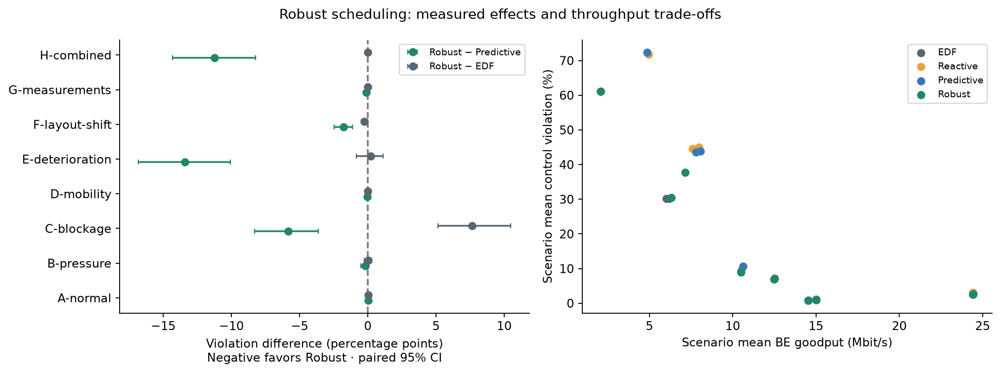
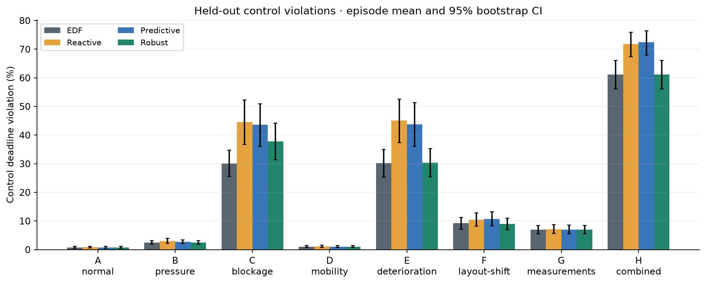
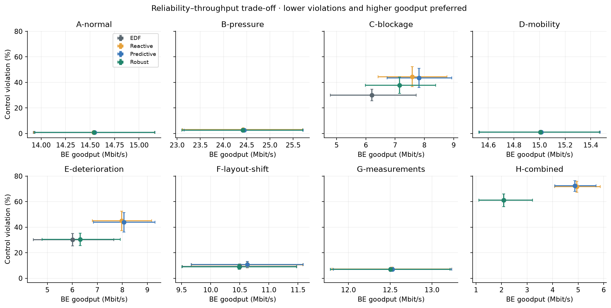
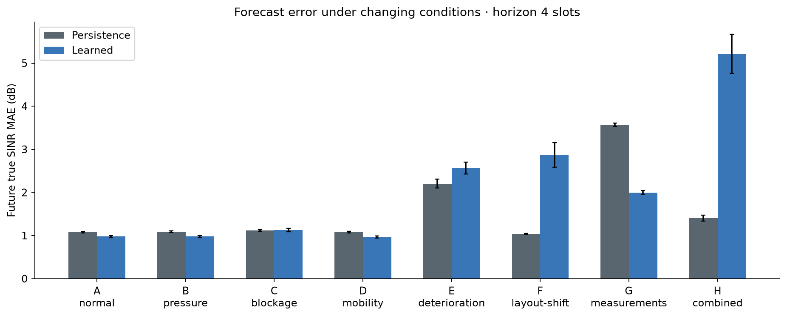
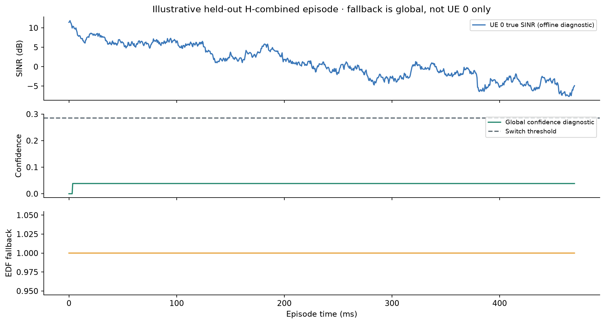
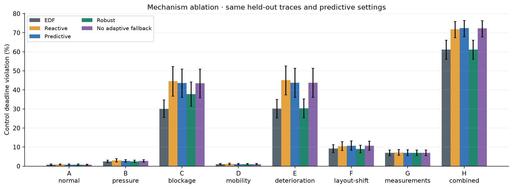

# Robust scheduling v2 — measured study

Profile: **full**. Completed **2,160 episode-policy executions**,
with **30 independent seeds per condition** and nine policies.
The eight conditions use disjoint seed ranges. Historical test evidence was not reused.

Frozen code revision: `db21e0ae3d5bb0db210cb570d3f5eb5014dc543b`.
Source hash: `ac16b29780fd1b78a1636edc30dfe568f81bed37d80cd86a737aec99fc9da0e7`.
Selected settings: `{'shift_scale': 0.1, 'smoothing': 0.05, 'threshold': 2.5}`.

## Primary paired differences

Robust minus reference, pp. Negative favors Robust. Percentile bootstrap resamples matched episodes
10,000 times. Intervals are marginal; many comparisons are not multiplicity-adjusted. No universal superiority claim.

| Scenario | Versus predictive: pp [95% CI] | Versus EDF: pp [95% CI] | Robust BE Mbit/s | Fallback % slots |
|---|---:|---:|---:|---:|
| A-normal | 0.028 [-0.007, 0.069] | 0.042 [-0.007, 0.090] | 14.540 | 23.5 |
| B-pressure | -0.187 [-0.493, 0.090] | 0.021 [-0.236, 0.299] | 24.414 | 26.6 |
| C-blockage | -5.826 [-8.292, -3.625] | 7.632 [5.146, 10.486] | 7.154 | 35.5 |
| D-mobility | -0.028 [-0.132, 0.056] | 0.000 [0.000, 0.000] | 15.007 | 100.0 |
| E-deterioration | -13.396 [-16.827, -10.083] | 0.222 [-0.819, 1.132] | 6.311 | 95.3 |
| F-layout-shift | -1.764 [-2.451, -1.111] | -0.257 [-0.486, -0.049] | 10.490 | 98.0 |
| G-measurements | -0.104 [-0.292, 0.076] | 0.000 [0.000, 0.000] | 12.502 | 100.0 |
| H-combined | -11.243 [-14.320, -8.215] | 0.000 [0.000, 0.000] | 2.087 | 100.0 |

## Computational cost

Mean of episode timings; P99 column is the mean of within-episode P99 values, not a pooled P99.
Scheduler timing includes residual monitoring and gating, excludes precomputed model inference.
Batch inference time is separately recorded per episode in prediction_metrics.csv.
Process workers compete for CPU; these are descriptive Python timings, not real-time RAN measurements.

| Policy | Mean µs | Mean episode P99 µs | Relative to EDF | Relative to predictive |
|---|---:|---:|---:|---:|
| EDF | 157.1 | 257.1 | 1.00× | 0.62× |
| Reactive | 184.2 | 308.7 | 1.17× | 0.72× |
| Predictive | 255.4 | 485.6 | 1.63× | 1.00× |
| Robust | 203.1 | 369.2 | 1.29× | 0.80× |
| No adaptive fallback | 273.5 | 497.2 | 1.74× | 1.07× |

## Interpretation and artifact map

Compare summary.csv for all secondary metrics, paired_comparisons.csv for effect intervals,
prediction_metrics.csv for true-SINR errors and empirical observable q90 coverage,
confidence_errors.csv for error conditional on diagnostic confidence, and pareto.csv for descriptive frontiers.
The static calibration q90 is an empirical residual band, not a conformal guarantee: correlated time series,
feature shift, noisy delayed targets and threshold selection invalidate such a shortcut.
No-adaptation retains mandatory invalid-forecast EDF fallback; it disables only the risk-driven switch.
Persistence and reactive decisions coincide when persistence uses the same expected current service.
Latency is conditional on delivery; failure counts and violation ratios must accompany it.
Synthetic channels, short windows and heuristic scheduling do not establish industrial safety or URLLC.

