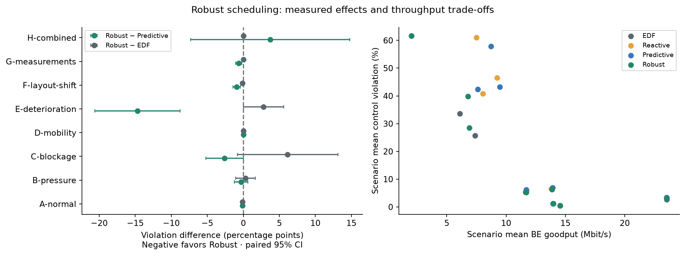
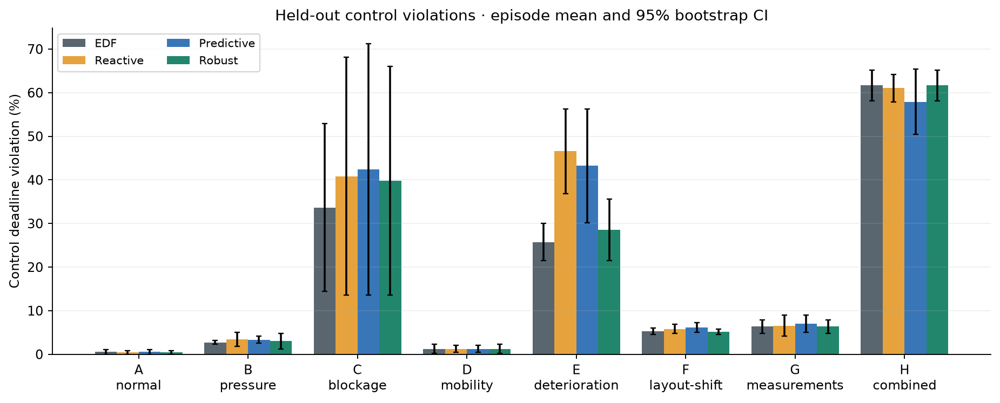
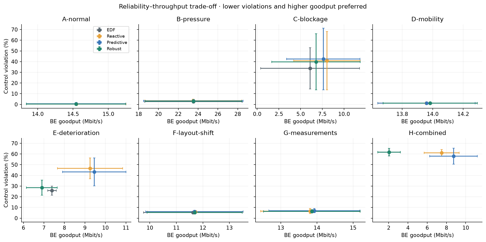
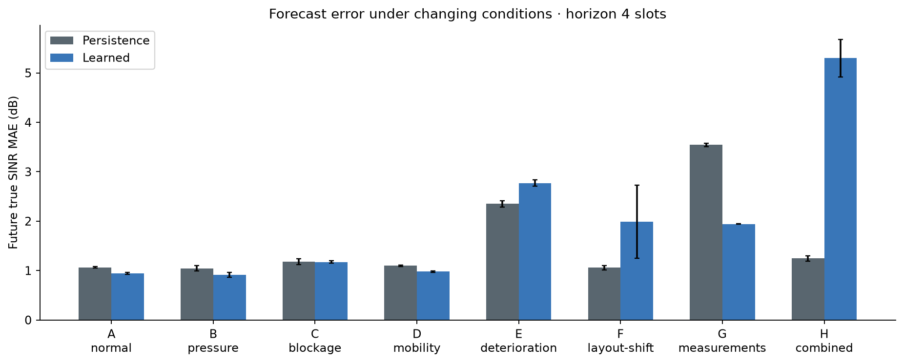
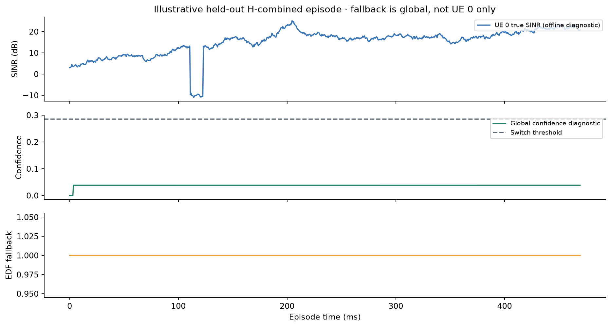
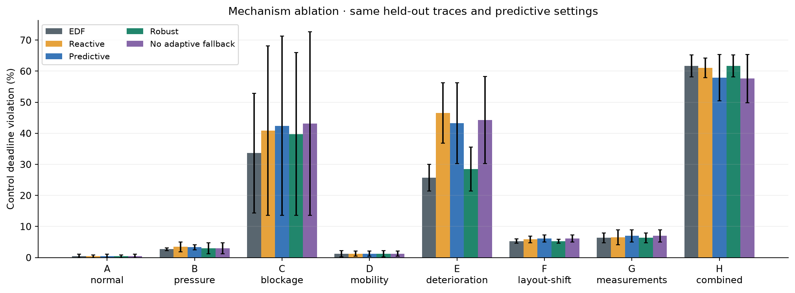

# Robust scheduling v2 — measured study

Profile: **quick**. Completed **144 episode-policy executions**,
with **2 independent seeds per condition** and nine policies.
The eight conditions use disjoint seed ranges. Historical test evidence was not reused.

Frozen code revision: `db21e0ae3d5bb0db210cb570d3f5eb5014dc543b`.
Source hash: `ac16b29780fd1b78a1636edc30dfe568f81bed37d80cd86a737aec99fc9da0e7`.
Selected settings: `{'shift_scale': 0.1, 'smoothing': 0.05, 'threshold': 2.5}`.

## Primary paired differences

Robust minus reference, pp. Negative favors Robust. Percentile bootstrap resamples matched episodes
10,000 times. Intervals are marginal; many comparisons are not multiplicity-adjusted. No universal superiority claim.

| Scenario | Versus predictive: pp [95% CI] | Versus EDF: pp [95% CI] | Robust BE Mbit/s | Fallback % slots |
|---|---:|---:|---:|---:|
| A-normal | -0.104 [-0.208, 0.000] | -0.104 [-0.208, 0.000] | 14.543 | 17.3 |
| B-pressure | -0.313 [-1.250, 0.625] | 0.312 [-1.042, 1.667] | 23.537 | 13.4 |
| C-blockage | -2.604 [-5.208, 0.000] | 6.146 [-0.833, 13.125] | 6.772 | 36.8 |
| D-mobility | -0.000 [-0.208, 0.208] | 0.000 [0.000, 0.000] | 13.984 | 100.0 |
| E-deterioration | -14.688 [-20.625, -8.750] | 2.812 [0.000, 5.625] | 6.898 | 96.0 |
| F-layout-shift | -0.938 [-1.458, -0.417] | -0.104 [-0.208, 0.000] | 11.692 | 81.0 |
| G-measurements | -0.625 [-1.042, -0.208] | 0.000 [0.000, 0.000] | 13.862 | 100.0 |
| H-combined | 3.750 [-7.292, 14.792] | 0.000 [0.000, 0.000] | 2.032 | 100.0 |

## Computational cost

Mean of episode timings; P99 column is the mean of within-episode P99 values, not a pooled P99.
Scheduler timing includes residual monitoring and gating, excludes precomputed model inference.
Batch inference time is separately recorded per episode in prediction_metrics.csv.
Process workers compete for CPU; these are descriptive Python timings, not real-time RAN measurements.

| Policy | Mean µs | Mean episode P99 µs | Relative to EDF | Relative to predictive |
|---|---:|---:|---:|---:|
| EDF | 153.3 | 249.3 | 1.00× | 0.63× |
| Reactive | 179.2 | 302.8 | 1.17× | 0.73× |
| Predictive | 243.9 | 464.5 | 1.59× | 1.00× |
| Robust | 200.4 | 371.6 | 1.31× | 0.82× |
| No adaptive fallback | 261.0 | 476.3 | 1.70× | 1.07× |

## Interpretation and artifact map

Compare summary.csv for all secondary metrics, paired_comparisons.csv for effect intervals,
prediction_metrics.csv for true-SINR errors and empirical observable q90 coverage,
confidence_errors.csv for error conditional on diagnostic confidence, and pareto.csv for descriptive frontiers.
The static calibration q90 is an empirical residual band, not a conformal guarantee: correlated time series,
feature shift, noisy delayed targets and threshold selection invalidate such a shortcut.
No-adaptation retains mandatory invalid-forecast EDF fallback; it disables only the risk-driven switch.
Persistence and reactive decisions coincide when persistence uses the same expected current service.
Latency is conditional on delivery; failure counts and violation ratios must accompany it.
Synthetic channels, short windows and heuristic scheduling do not establish industrial safety or URLLC.

